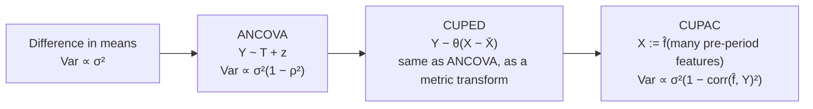

# 12 Variance reduction with covariates: ANCOVA, CUPED and CUPAC

**Not in the STAT 404 notes** (ANCOVA is named in one paragraph of sec. 10.6) · [back to the graph](../README.md)

**What is learned:** the same treatment effect as a plain difference in means, but with a smaller standard
error, by subtracting the part of the response that pre-treatment information already predicts.

This folder was added on request. "CUPA" in the request is read as **CUPAC** (Control Using Predictions As
Covariates), the machine-learning extension of CUPED. If you meant something else, say so and the folder
can be adjusted.

## Sources

| Method | Where it comes from |
| --- | --- |
| ANCOVA | Fisher (1932); Cox, *Planning of Experiments* (1958) ch. 4; the notes' sec. 10.6 sets up the model |
| Lin's interacted ANCOVA | Lin (2013), "Agnostic notes on regression adjustments to experimental data", *Annals of Applied Statistics* |
| CUPED | Deng, Xu, Kohavi & Walker (2013), "Improving the sensitivity of online controlled experiments by utilizing pre-experiment data", WSDM (Microsoft Bing) |
| CUPAC | Tang, Huang & Grinstead (2020), "Improving experimental power through control using predictions as covariate", DoorDash engineering blog; see also Guo et al. (2021) "MLRATE" (Meta) |

## One idea, three versions

In every randomized experiment the response varies for reasons unrelated to the treatment. If a variable `X`
measured *before* randomization predicts `Y`, subtract its prediction: the treatment effect does not change
(randomization makes `X` balanced in expectation) but the noise does.



### ANCOVA (analysis of covariance)

Fit `Y = a + τT + β(z − z̄) + E` by least squares in a randomized experiment. Compared with the difference in
means (DiM):

| Estimator | What it does | Variance relative to DiM (Var Y = Var z, correlation ρ) |
| --- | --- | --- |
| difference in means | ignores z | 1 |
| change score `y − z` | fixes the slope at 1 | 2(1 − ρ): better only when ρ > ½ |
| ANCOVA | estimates the slope | **1 − ρ²**: never worse, asymptotically |

**Lin's version** adds `T × (z − z̄)` and uses robust (HC2) standard errors. It stays at least as precise as
DiM even when effects are heterogeneous or the linear model is wrong, answering Freedman's (2008) critique of
regression adjustment.

**The rule that keeps it unbiased:** the covariate must not be affected by the treatment (the notes' sec. 10.6,
after Cox). Adjust for something measured before randomization, or something the treatment cannot change.
Adjusting for a post-treatment variable (a mediator) removes part of the effect you are trying to measure.

### CUPED (Controlled-experiment Using Pre-Experiment Data)

The online-experiment version. For each user, `X` = the same metric in the weeks *before* the experiment.

```
θ = Cov(X, Y) / Var(X)          (pooled over both arms)
Y_cv = Y − θ (X − X̄)
Δ_CUPED = Ȳ_cv,T − Ȳ_cv,C = Δ_DiM − θ (X̄_T − X̄_C)
```

- **Unbiased** for any fixed θ, since `E[X̄_T − X̄_C] = 0` under randomization.
- **Variance** `Var(Y)(1 − ρ²)`: a pre/post correlation of 0.7 halves the variance, so the experiment needs
  half the users, or detects a √2 smaller effect.
- **It is ANCOVA.** With the slope estimated on the pooled data instead of jointly with `T`, the two agree to
  `O(1/n)` (identical to 4 decimals in the demo below). The reason CUPED is used anyway is engineering: it is a
  per-user transformation of the metric, so the existing t-test pipeline, dashboards and delta-method ratio
  metrics work unchanged.
- **Practicalities.** New users have no pre-period: set `X = 0` and add a "has history" indicator (or use
  several covariates with `θ = Σ_XX⁻¹ Σ_XY`). Longer pre-periods raise ρ with diminishing returns. Never
  take `X` from after the experiment started.

### CUPAC (Control Using Predictions As Covariates)

CUPED's variance reduction is limited to the *linear* correlation of one pre-period metric with `Y`. When
many pre-experiment features `W` (history, tenure, geography, device, …) predict `Y` non-linearly, a better
single covariate is a model's prediction `f̂(W)`. CUPAC is CUPED with `X := f̂(W)`; the variance reduction is
`corr(f̂(W), Y)²`.

It stays unbiased as long as:

1. every feature is pre-treatment, and
2. `f̂` does not learn from the treatment assignment. Either train it on a historical period (the original
   DoorDash setup) or **cross-fit** on the experiment's own data without the treatment label: predict each
   fold with a model trained on the other folds (the idea behind MLRATE and double/debiased ML).

Because θ is still estimated on top, a useless model gives θ ≈ 0 and you are back to DiM, not worse.

## Code in this folder

| File | What it does |
| --- | --- |
| [`ancova.py`](ancova.py) | DiM, change score, ANCOVA, Lin's interacted ANCOVA with HC2 SEs; a variance table over ρ; CI coverage; the post-treatment-covariate bias |
| [`cuped.py`](cuped.py) | θ, the CUPED transform, Welch CI, sample-size formula; a simulated sessions-per-user A/B test; ANCOVA equivalence; power over 1000 experiments |
| [`cupac.py`](cupac.py) | non-linear user features, a gradient-boosted model trained on a historical period and a 5-fold cross-fitted model, CUPED vs CUPAC over 1000 experiments |

```bash
python 12-variance-reduction-ancova-cuped-cupac/ancova.py    # ~5 s
python 12-variance-reduction-ancova-cuped-cupac/cuped.py     # ~3 s
python 12-variance-reduction-ancova-cuped-cupac/cupac.py     # ~25 s
```

**ANCOVA** (n = 200, 4000 simulated experiments, sd of the estimate of τ):

| ρ | DiM | change score | ANCOVA | Lin | change/DiM (theory) | ANCOVA/DiM (theory) |
| --- | --- | --- | --- | --- | --- | --- |
| 0.0 | 0.142 | 0.199 | 0.143 | 0.143 | 1.40 (1.41) | 1.00 (1.00) |
| 0.3 | 0.141 | 0.168 | 0.135 | 0.135 | 1.19 (1.18) | 0.95 (0.95) |
| 0.5 | 0.140 | 0.141 | 0.122 | 0.122 | 1.01 (1.00) | 0.87 (0.87) |
| 0.7 | 0.141 | 0.108 | 0.100 | 0.100 | 0.77 (0.77) | 0.71 (0.71) |
| 0.9 | 0.143 | 0.063 | 0.061 | 0.061 | 0.44 (0.45) | 0.43 (0.44) |

ANCOVA 95% CI coverage at ρ = 0.7: 0.952. With a true total effect of 1.0, adjusting for a pre-treatment
covariate gives bias +0.000; adjusting for a post-treatment mediator gives **−0.800**.

**CUPED** (Poisson sessions per user driven by a log-normal propensity, 2% lift, n = 20 000):

| | value |
| --- | --- |
| corr(pre-period, in-experiment), θ | 0.87, 0.88 |
| se: plain t-test vs CUPED (one experiment) | 0.110 vs 0.054; variance ratio 0.240 = 1 − ρ² |
| ANCOVA coefficient on T vs CUPED Δ | +0.0907 vs +0.0907 |
| 1000 experiments, true Δ = 0.150: mean, sd | plain 0.143, 0.111; CUPED 0.147, 0.056 |
| power at the 2% lift | plain **0.28**, CUPED **0.78** |
| users per arm for 80% power | plain 40 265, CUPED 9 671 |

**CUPAC** (4 non-linear user features plus a noisy pre-period metric, true τ = 0.15, n = 8000):

| 1000 experiments | mean | sd | 95% CI coverage | power | variance vs plain |
| --- | --- | --- | --- | --- | --- |
| plain t-test | 0.150 | 0.074 | 0.959 | 0.49 | 1 |
| CUPED on the pre-period metric (corr² 0.57) | 0.150 | 0.050 | 0.952 | 0.85 | 0.46 |
| CUPAC, model trained on history (corr² 0.78) | 0.149 | 0.035 | 0.949 | **0.98** | **0.23** |

The 5-fold cross-fitted model reaches the same corr² (0.77) without any historical data.

## Knowledge gap

**What the notes and this folder leave out**

- **Ratio metrics** (clicks per session, revenue per order): CUPED is applied to numerator and denominator and
  combined with the delta method. Deng et al. (2013) sec. 3.4; Deng, Knoblich & Lu (2018), KDD.
- **Heavy tails.** Capping or winsorizing the metric before CUPED often matters as much as CUPED itself.
- **Stratification and post-stratification** are CUPED with categorical covariates.
- **Sequential testing** (always-valid p-values, mSPRT) combined with CUPED.
- **Cluster-randomized experiments** need covariates at the cluster level and the right error term
  ([11](../11-split-plot-and-repeated-measures/)).
- **Heterogeneous effects:** with Lin's interaction the coefficient on T is the average effect at the
  covariate mean; the interaction coefficients describe how the effect varies, which is exploratory.

**Prerequisites to shore up**

- [01 Linear models](../01-linear-models/) (the extra column), [09 Randomization](../09-randomization-blocking-replication/)
  (why `E[X̄_T − X̄_C] = 0`), control variates in Monte Carlo integration.

**Open questions / further study**

- How much does cross-fitting cost in finite samples compared with a model trained on separate historical data?
- When an experiment changes *who* shows up (a signup flow), the outcome is only defined for some users;
  covariate adjustment on the triggered population needs care. Kohavi, Tang & Xu, *Trustworthy Online
  Controlled Experiments* (2020), ch. 20 and 22.

## Connections

- ← [09 Counter-measures](../09-randomization-blocking-replication/): sec. 10.6 is where the notes introduce
  covariates; this folder finishes the thought.
- ← [01 Linear models](../01-linear-models/): ANCOVA is one more column in `X`.
- ← [03 Randomized blocks](../03-randomized-blocks-and-two-way/): blocking on a covariate at design time vs adjusting
  for it at analysis time.
- ← [11 Split-plot](../11-split-plot-and-repeated-measures/): cluster-randomized A/B tests are split plots.
