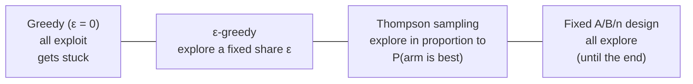

# 13 Adaptive experiments: the exploration/exploitation trade-off, epsilon-greedy and Thompson sampling

**Not in the STAT 404 notes** · [back to the graph](../README.md)

**What is learned:** how to run an experiment that *changes its allocation as the data come in*, giving more
units to the arms that look better, and what that buys (reward during the experiment) and costs (precision and
unbiasedness of the final comparison).

## Sources

| Method | Where it comes from |
| --- | --- |
| Bandit problem, regret lower bound | Robbins (1952), "Some aspects of the sequential design of experiments", *Bull. AMS*; Lai & Robbins (1985), *Adv. Appl. Math.* |
| Epsilon-greedy | Sutton & Barto, *Reinforcement Learning* (2nd ed., 2018) ch. 2 |
| Thompson sampling | Thompson (1933), *Biometrika*; Russo, Van Roy et al. (2018), "A Tutorial on Thompson Sampling", *Found. Trends ML* |
| UCB1 (for comparison) | Auer, Cesa-Bianchi & Fischer (2002), *Machine Learning* |
| Inference after adaptive allocation | Nie, Tian, Taylor & Zou (2018), "Why adaptively collected data have negative bias", AISTATS; Hadad et al. (2021), *PNAS* |

Robbins' 1952 paper is titled *sequential design of experiments*: the bandit problem was born as a design
problem, the question every chapter of the notes answers with a fixed plan ("which unit gets which
treatment?") asked again *after each unit*.

## The trade-off

Every design in folders 00–12 fixes the allocation before the first response is seen: a CRD with equal
replication gives each of K treatments `n/K` units no matter how badly one of them is doing. That is right
when the only goal is to **learn** the treatment effects as precisely as possible.

Often the units are also customers or patients, and every unit given a worse arm is a real loss. Then two
goals compete:

- **Exploit:** give the next unit the arm that currently looks best. Earns reward now.
- **Explore:** give it an arm that currently looks worse, because with few observations it may only *look*
  worse. Earns information, which improves every later decision.

Pure exploitation (always pick the current leader, "greedy") is the classic failure: an arm that is unlucky
in its first few units gets a low estimate, is never chosen again, and so its estimate is never corrected. In
the simulation below greedy (ε = 0) ends up on the best arm only 29% of the time. Pure exploration (the fixed
A/B/n test) never fails that way, but keeps sending a quarter of the traffic to the worst arm until the end.



### Regret: the score for the trade-off

With true rates `p_k`, best rate `p*`, and `N_k(T)` the number of units given arm k out of T,

```
Regret(T) = T·p* − Σ_t p_{A_t} = Σ_k (p* − p_k) · E[N_k(T)]
```

the expected number of conversions lost to not knowing which arm is best. It is a sum over arms of
*(how much worse the arm is) × (how many units it got)*: good policies spend few units on clearly bad arms and
more on arms that are close to the best (those are hard to tell apart, and cheap to sample).

| Policy | How regret grows with T |
| --- | --- |
| fixed equal allocation | linear: `T (p* − p̄)` |
| greedy | linear (with a fixed probability it locks onto a wrong arm) |
| ε-greedy, fixed ε | linear: about `ε T (p* − p̄)` from the forced exploration |
| ε-greedy with decaying ε, UCB, Thompson sampling | **logarithmic**, `O(log T)` |

Lai and Robbins showed `O(log T)` is the best possible: any policy that eventually finds the best arm must
give each worse arm at least about `log T / KL(p_k, p*)` units. Thompson sampling attains this constant.

## Epsilon-greedy

The simplest rule that explores on purpose.

```
for each unit t:
    with probability ε : choose an arm uniformly at random           (explore)
    otherwise          : choose the arm with the highest s_k / n_k   (exploit)
    observe the reward; update s_k, n_k
```

- **ε is the dial.** ε = 0 is greedy, ε = 1 is the fixed equal-allocation design. Small ε risks staying stuck
  on a wrong arm for a long time; large ε wastes units on arms already known to be bad.
- **Exploration is blind.** An arm that is clearly terrible after 5 000 units is explored exactly as often as
  one that is neck and neck with the leader.
- **Decaying ε** (`ε_t = min(1, cK/t)`) explores heavily at first and less as evidence accumulates, which
  makes regret logarithmic, but the right `c` depends on the unknown gaps between arms.
- **A design virtue:** every unit's assignment probability is known (`ε/K` or `1 − ε + ε/K`), so the ε share
  is a genuinely randomized experiment and inverse-probability weighting gives unbiased estimates.

## Thompson sampling

Put a prior on every arm's rate, and for each new unit **play each arm with the posterior probability that it
is the best arm** ("probability matching"). The cheap way to do that is to draw once from each posterior and
take the largest draw.

For conversions (Bernoulli rewards) with a Beta(1, 1) (uniform) prior, the posterior after `s_k` successes in
`n_k` units is `Beta(1 + s_k, 1 + n_k − s_k)`:

```
for each unit t:
    for each arm k: draw θ_k ~ Beta(1 + s_k, 1 + n_k − s_k)
    choose the arm with the largest θ_k
    observe the reward; update s_k, n_k
```

Why it balances the trade-off by itself:

- An arm with **few observations** has a wide posterior, so it sometimes produces the largest draw even if its
  mean is lower: uncertain arms get explored.
- An arm with **many observations and a low rate** has a narrow posterior sitting below the leader: it almost
  never wins the draw, so exploration of clearly bad arms stops on its own.
- No tuning parameter like ε; the amount of exploration is set by the data.

It works with any reward model that has a posterior you can sample from: Normal rewards with a Normal prior,
Poisson counts with a Gamma prior, or a Bayesian regression for *contextual* bandits (rewards that depend on
user features).

### Worked example (two arms, by hand)

After 22 units, arm A converted 3 of 10 and arm B 6 of 12. Which arm does the next unit get?

| | A | B |
| --- | --- | --- |
| data | 3 / 10 | 6 / 12 |
| posterior (Beta(1, 1) prior) | Beta(4, 8), mean 0.333 | Beta(7, 7), mean 0.500 |

- **ε-greedy, ε = 0.1:** B leads, so `P(B) = 0.9 + 0.1 × ½ = 0.95`, `P(A) = 0.05`, whatever the sample sizes.
- **Thompson sampling:** `P(B) = P(p_B > p_A | data) = ∫ f_A(x) P(p_B > x) dx = 0.815`. Twenty-two units is little
  evidence, so A still gets almost a fifth of the next units. Had the same rates come from 3 000 and 6 000
  conversions out of 10 000 and 12 000, `P(B)` would be essentially 1 and A would be dropped.

That contrast is the whole difference: ε-greedy explores a fixed share, Thompson explores as much as the
remaining uncertainty justifies.

## The design cost: inference after adaptive allocation

A bandit is optimized for reward *during* the experiment, not for the comparison at the end. Two consequences:

1. **Less precision for the losing arms.** Losing arms get few units, so the SE of "best vs control" is much
   larger than in a fixed design with the same total (the `sd lift` column below: 0.0115 vs 0.0045).
2. **Biased arm means.** An arm that is unlucky early is sampled less, so its bad luck is not averaged away,
   while an arm that is lucky early is sampled more and regresses back. Net effect: the sample mean `s_k / n_k`
   is biased **downward** (Nie et al. 2018). The plain t-test and its CI are not valid either, since `n_k` depends
   on the outcomes.

Fixes, in rising order of effort: keep a fixed **uniform-random holdout** for estimation; use **ε-greedy and
inverse-probability weighting** with the logged assignment probabilities; use adaptively weighted estimators
(Hadad et al. 2021) or always-valid inference. In practice, a bandit is the right tool when the decision *is*
the allocation (which headline to show today, a short promotion, many arms) and a fixed A/B test when the
goal is a trustworthy effect estimate to make a lasting decision.

## Code in this folder

| File | What it does |
| --- | --- |
| [`bandits.py`](bandits.py) | equal allocation, ε-greedy (fixed and decaying), Thompson sampling and UCB1, vectorized over simulated experiments; regret curves; the ε dial; bias and SE of the final estimates; the worked example; posterior P(best) |

```bash
python 13-adaptive-experiments-bandits/bandits.py    # ~10 s
```

**Four arms** (control 4.0%, variants 5.0%, 5.5%, 6.0% conversion), 20 000 units, 400 simulated experiments
per policy. Regret is in conversions lost; "picks best" is how often the arm with the highest final sample mean is
the true best; "bias ctrl" is the mean error of the control's sample mean; "sd lift" is the sd of the estimated
best − control difference.

| Policy | regret @1k | @5k | @20k | share to best | picks best | units to control | bias ctrl | sd lift |
| --- | --- | --- | --- | --- | --- | --- | --- | --- |
| equal allocation (A/B/n) | 8.8 | 43.7 | 174.9 | 0.25 | 0.82 | 4 998 | −0.0002 | **0.0045** |
| ε-greedy, ε = 0.1 | 6.9 | 23.5 | 62.9 | 0.59 | 0.73 | 762 | −0.0014 | 0.0094 |
| ε-greedy, decaying (c = 100) | 7.7 | 22.3 | 52.8 | 0.65 | 0.73 | 533 | −0.0010 | 0.0095 |
| Thompson sampling | 7.0 | 24.5 | 57.4 | 0.64 | **0.90** | 739 | **−0.0049** | 0.0115 |
| UCB1 | 8.3 | 39.3 | 143.6 | 0.32 | 0.87 | 3 492 | −0.0003 | 0.0047 |

- Thompson sampling loses **a third** of the conversions the fixed design loses, and is also the most likely to
  end on the right arm.
- The fixed design wins on the comparison: the smallest sd of the lift, an unbiased control rate. Under Thompson
  sampling the control's rate is underestimated by 0.0049, 12% of its true 4%.
- UCB1 with its textbook bonus `√(2 ln t / n)` explores far too much here: the bonus is sized for rewards
  anywhere in [0, 1], while conversion rates near 5% vary much less. KL-UCB fixes this.

**The ε dial** (same arms, 20 000 units):

| ε | 0 (greedy) | 0.02 | 0.05 | 0.1 | 0.2 | 0.5 |
| --- | --- | --- | --- | --- | --- | --- |
| regret | 155.5 | 80.9 | 72.6 | 65.2 | 66.7 | 106.1 |
| picks best | 0.29 | 0.58 | 0.64 | 0.71 | 0.82 | 0.86 |

Too little exploration (greedy gets stuck on a wrong arm 71% of the time) and too much (half the traffic spread
uniformly) both cost; the minimum is in between, and where it lies depends on the gaps and the horizon.

## Knowledge gap

**What this folder leaves out**

- **Best-arm identification** (pure exploration with adaptive allocation): when the goal is to find the best arm
  with few units rather than to earn reward, *top-two Thompson sampling* (Russo 2020) is the better rule.
- **Contextual bandits:** the best arm depends on user features (LinUCB, Thompson sampling with a Bayesian
  regression). This is personalization, and connects to CUPAC's prediction models in [12](../12-variance-reduction-ancova-cuped-cupac/).
- **Delayed and batched feedback:** in practice rewards arrive hours later and allocations are updated in
  batches; Thompson sampling degrades gracefully, greedy-type rules less so.
- **Non-stationarity:** rates drift (weekday vs weekend). Discounted or sliding-window posteriors.
- **Response-adaptive randomization in clinical trials:** the same idea under regulatory scrutiny, with the
  debate on time trends and bias (Thall & Wathen 2007; Robertson et al. 2023, *Statistical Science*).

**Prerequisites to shore up**

- Beta–Binomial conjugacy and posterior sampling; the KL divergence between Bernoullis.
- [Basics](../basics-variance-and-standard-errors/): why SE ∝ 1/√n makes starved arms so imprecise.
- [09 Randomization](../09-randomization-blocking-replication/): why known assignment probabilities are what
  make unbiased estimation possible.

**Open questions / further study**

- How should regret be traded against the precision of the final effect estimate? (Bandits with a minimum
  allocation per arm; "ε-first" designs that run a short fixed test and then exploit.)
- Lattimore & Szepesvári, *Bandit Algorithms* (2020), free online; Russo et al. (2018) for Thompson sampling;
  Kohavi, Tang & Xu (2020) for when online teams use bandits instead of A/B tests.

## Connections

- ← [02 Completely randomized designs](../02-completely-randomized-designs/): a CRD with equal replication is
  the bandit's "pure exploration" baseline.
- ← [09 Randomization](../09-randomization-blocking-replication/): adaptive allocation is still randomized,
  with assignment probabilities that change over time; inference must use them.
- ← [Basics](../basics-variance-and-standard-errors/): sample size per arm sets each arm's SE, which is what
  the final comparison loses.
- ↔ [12 CUPED/CUPAC](../12-variance-reduction-ancova-cuped-cupac/): two ways to spend fewer units on an
  experiment. Variance reduction makes each unit more informative; a bandit sends fewer units to bad arms.
