# Design of experiments: a knowledge graph of STAT 404 + modern variance reduction

Notes and code for **STAT 404, Design and Analysis of Experiments** (UBC, course notes by W. J. Welch,
version of August 2025), plus one folder that the notes do not cover: **ANCOVA, CUPED and CUPAC**, the
covariate-adjustment methods behind modern online A/B testing.

Every design or analysis method in the notes lives in exactly one topic folder. Each folder's README has the
chapter sections it comes from, an explanation of every method in my own words (what it estimates, how the
design is built, the key equations), the code written for it with results, a **knowledge gap** section, and how
the topic connects to the others.

**Knowledge gap** means three things in every folder: *what the notes leave out* (theory, modern methods and
practical details beyond the course), *prerequisites to shore up* before the topic makes sense, and *open
questions* with concrete readings for going further.

> The course notes are copyrighted and are **not** included here. Everything in this repository (text, code,
> simulated data) is original; section numbers refer to the notes so you can read along.

## The graph

Click a node to open its folder. Edges are the conceptual links between topics, labelled with the idea that
carries over.

```mermaid
flowchart LR
    BA["Basics<br/>variance · SD vs SE · pooled vs Welch"]
    I["00 Introduction<br/>comparative · controlled · randomized"]
    subgraph A["Part I: Analysis (ch. 2–6)"]
        LM["01 Linear models<br/>least squares · ANOVA · F tests · Box-Cox"]
        CRD["02 Completely randomized designs<br/>one-way ANOVA · contrasts"]
        RBD["03 Randomized blocks<br/>RBD · 2-way factorial · non-additivity"]
        FAC["04 Factorial experiments<br/>interactions · 1-DF contrasts"]
        TWO["05 2-level factorials<br/>±1 contrasts · half-normal plots · OFAT"]
    end
    subgraph P["Part II: Planning (ch. 7–10)"]
        BLK["06 Blocking 2^p designs<br/>confounding · generators"]
        FRC["07 Fractional factorials<br/>aliasing · resolution · foldover"]
        LS["08 Latin squares<br/>two blocking factors · Graeco-Latin"]
        CM["09 Counter-measures<br/>randomization tests · blocking · replication"]
    end
    subgraph S["Part III: Complex stochastic structure (ch. 11–12)"]
        RE["10 Random effects<br/>EMS · variance components"]
        SP["11 Split-plot and repeated measures<br/>two error strata"]
    end
    subgraph N["Beyond the notes"]
        VR["12 ANCOVA · CUPED · CUPAC<br/>covariate adjustment for A/B tests"]
    end

    BA -- "every test is estimate / SE" --> LM
    BA -- "pooled variance = MS(Residual)" --> CRD
    BA -- "Var(Y − θX) = Var(Y)(1 − ρ²)" --> VR
    I -- "every analysis is a linear model" --> LM
    I -- "randomization, blocking, replication" --> CM
    LM -- "a factor = dummy columns" --> CRD
    CRD -- "add a blocking factor" --> RBD
    CRD -- "structured treatments" --> FAC
    FAC -- "two levels: one ±1 column per effect" --> TWO
    TWO -- "lose high-order effects to blocks" --> BLK
    BLK -- "same word algebra" --> FRC
    RBD -- "two blocking factors" --> LS
    FRC -- "l² of l³ runs" --> LS
    RBD -- "blocks as a sample" --> RE
    RE -- "EMS choose the denominator" --> SP
    FAC -- "restricted randomization" --> SP
    CM -- "sec. 10.6: auxiliary variables" --> VR
    LM -- "one more column" --> VR
    RBD -- "block at design vs adjust at analysis" --> VR
    SP -- "cluster-randomized A/B tests" --> VR

    click BA "basics-variance-and-standard-errors/" "Basics"
    click I "00-introduction-and-principles/" "Introduction"
    click LM "01-linear-models/" "Linear models"
    click CRD "02-completely-randomized-designs/" "Completely randomized designs"
    click RBD "03-randomized-blocks-and-two-way/" "Randomized blocks"
    click FAC "04-factorial-experiments/" "Factorial experiments"
    click TWO "05-two-level-factorials/" "2-level factorials"
    click BLK "06-blocking-two-level-factorials/" "Blocking 2-level factorials"
    click FRC "07-fractional-factorials/" "Fractional factorials"
    click LS "08-latin-squares/" "Latin squares"
    click CM "09-randomization-blocking-replication/" "Counter-measures"
    click RE "10-random-effects/" "Random effects"
    click SP "11-split-plot-and-repeated-measures/" "Split-plot"
    click VR "12-variance-reduction-ancova-cuped-cupac/" "ANCOVA, CUPED, CUPAC"
```



New to the statistics? Start with [Basics](basics-variance-and-standard-errors/): variance vs standard deviation
vs standard error, why variances add when you subtract, and pooled vs Welch standard errors.

If the nodes are not clickable in your viewer (GitHub sometimes disables Mermaid links), use the table below.

## Topics, chapters and code

| Topic folder | Chapter (notes) | Methods explained | Code in this repo |
| --- | --- | --- | --- |
| [Basics: variance, SD, SE](basics-variance-and-standard-errors/) | used throughout | variance rules, SD vs SE, n − 1, variance of a difference, pooled vs Welch, paired, contrasts, proportions, % lift | [`basics.py`](basics-variance-and-standard-errors/basics.py) |
| [00 Introduction and principles](00-introduction-and-principles/) | 1 | features of a designed experiment, units, factors, levels, replication; historical examples | [`observational_vs_randomized.py`](00-introduction-and-principles/observational_vs_randomized.py) |
| [01 Linear models](01-linear-models/) | 2 | least squares, ANOVA, t and F tests, extra sum of squares, prediction intervals, Box-Cox, residuals | [`linear_model.py`](01-linear-models/linear_model.py) |
| [02 Completely randomized designs](02-completely-randomized-designs/) | 3 | one-way ANOVA, three regression codings, contrasts, orthogonal polynomial contrasts | [`crd.py`](02-completely-randomized-designs/crd.py) |
| [03 Randomized blocks and 2-way factorials](03-randomized-blocks-and-two-way/) | 4 | RBD, balance, relative efficiency, Tukey non-additivity, replicated 2-way factorial | [`rbd.py`](03-randomized-blocks-and-two-way/rbd.py) |
| [04 Factorial experiments](04-factorial-experiments/) | 5 | interaction effects, multi-way ANOVA, 1-DF main and interaction contrasts, polynomial model | [`factorial.py`](04-factorial-experiments/factorial.py) |
| [05 2-level factorials](05-two-level-factorials/) | 6 | ±1 contrast matrix, effects and SEs, normal / half-normal plots, Lenth's PSE, OFAT | [`two_level.py`](05-two-level-factorials/two_level.py) |
| [06 Blocking 2-level factorials](06-blocking-two-level-factorials/) | 7 | confounding with blocks, generators, defining relation, pseudo factors | [`blocking.py`](06-blocking-two-level-factorials/blocking.py) |
| [07 Fractional factorials](07-fractional-factorials/) | 8 | 2^(p−q) fractions, aliasing, resolution, minimum aberration, foldover, screening | [`fractional.py`](07-fractional-factorials/fractional.py) |
| [08 Latin squares](08-latin-squares/) | 9 | construction, randomization, ANOVA, Graeco-Latin squares | [`latin_square.py`](08-latin-squares/latin_square.py) |
| [09 Randomization, blocking, replication](09-randomization-blocking-replication/) | 10 | experimental vs observational, randomization tests, replication, auxiliary variables | [`randomization.py`](09-randomization-blocking-replication/randomization.py) |
| [10 Random effects](10-random-effects/) | 11 | fixed vs random, expected mean squares, variance components, prediction | [`random_effects.py`](10-random-effects/random_effects.py) |
| [11 Split-plot and repeated measures](11-split-plot-and-repeated-measures/) | 12 | whole-plot and sub-plot factors, two error strata, repeated measures | [`split_plot.py`](11-split-plot-and-repeated-measures/split_plot.py) |
| [12 ANCOVA, CUPED, CUPAC](12-variance-reduction-ancova-cuped-cupac/) | beyond the notes (10.6) | ANCOVA, Lin's estimator, CUPED, CUPAC with historical and cross-fitted models | [`ancova.py`](12-variance-reduction-ancova-cuped-cupac/ancova.py), [`cuped.py`](12-variance-reduction-ancova-cuped-cupac/cuped.py), [`cupac.py`](12-variance-reduction-ancova-cuped-cupac/cupac.py) |

Chapter 13 of the notes holds exercise solutions and has no folder.

## The thread through the course: what does the design buy?

A useful way to read the graph is to ask, for each folder, *which source of error the design removes and what
it costs*:

- **Bias from unknown variables** (00, 09): removed by randomization, at no cost in runs.
- **Variance from known nuisance variables** (03, 06, 08, 12): removed by blocking at design time or covariate
  adjustment at analysis time, at the cost of a few error DF.
- **Variance per effect** (04, 05): factorial designs reuse every run for every effect, so many factors cost
  hardly more than one.
- **Runs** (06, 07): fractions and blocked designs give up effects you are willing to assume negligible
  (high-order interactions) in exchange for fewer runs or smaller blocks.
- **Wrong error term** (10, 11): when randomization happens at two levels, there are two noise levels, and each
  comparison must be judged against its own.

## Knowledge gaps across the course

Each folder lists its own gaps. Four themes recur often enough to plan study around:

1. **Sample size and power.** No chapter plans *how many* runs to do. Noncentral F power calculations,
   minimum detectable effects and their link to variance reduction (12) are the first thing to add.
   Montgomery, *Design and Analysis of Experiments*, ch. 3.7; Kohavi, Tang & Xu, ch. 17.
2. **Multiple comparisons.** Contrasts and factorial effects are tested one at a time. Tukey, Scheffé, Holm and
   FDR control matter as soon as many effects are screened.
3. **Mixed models and REML.** The ANOVA/EMS approach of ch. 11–12 needs balance. Unbalanced data, missing runs
   and repeated measures with realistic correlation need `lme4`-style mixed models.
4. **Response surfaces and optimal design.** The notes stop at 2- and 3-level factorials; finding an optimum
   (central composite designs, steepest ascent) and computer-generated D-/I-optimal designs for irregular
   regions are the natural next course. Box & Draper; Goos & Jones, *Optimal Design of Experiments*.

## Run the code

```bash
python -m venv .venv && source .venv/bin/activate
pip install -r requirements.txt
python 05-two-level-factorials/two_level.py                 # any file runs on its own and prints its results
python -m pytest -q                                          # 27 checks against statsmodels, scipy, enumeration and closed forms
```

Every script finishes in a few seconds on a laptop CPU except `cupac.py` (about 25 s: it fits gradient-boosted
trees). Results quoted in the topic READMEs come from these scripts with their fixed random seeds.

## Layout

```
.
├── basics-variance-and-standard-errors/     start here: SD vs SE, variance of a difference, pooling
├── 00-introduction-and-principles/          each folder: README.md + one or more runnable .py files
├── 01-linear-models/
├── 02-completely-randomized-designs/
├── 03-randomized-blocks-and-two-way/
├── 04-factorial-experiments/
├── 05-two-level-factorials/
├── 06-blocking-two-level-factorials/
├── 07-fractional-factorials/
├── 08-latin-squares/
├── 09-randomization-blocking-replication/
├── 10-random-effects/
├── 11-split-plot-and-repeated-measures/
├── 12-variance-reduction-ancova-cuped-cupac/
├── tests/test_models.py                     correctness checks for every implementation
└── requirements.txt
```

## Conventions

- **From scratch.** Every method is NumPy, with SciPy only for distribution functions. The notes use R
  (`aov`, `lm`); the Python here computes the same tables directly so the formulas stay visible. scikit-learn
  is used only for CUPAC's gradient-boosted model; statsmodels only as a reference in the tests.
- **Simulated data.** The notes' datasets are not reproduced. Each script simulates data from a stated true
  model, so you can see whether a method recovers the truth, not only what it outputs.
- **One file per idea**, each with a docstring that states the design and its equations, and a `demo()` that
  prints the numbers quoted in the README.
